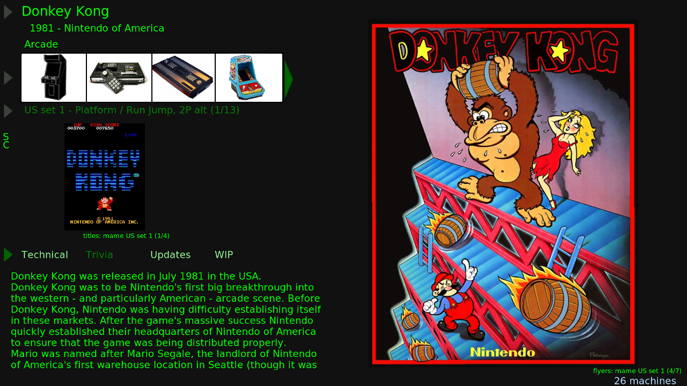
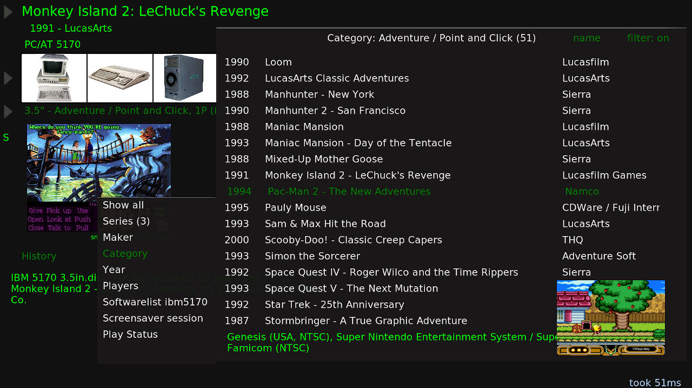

## Kodi Add-ons: a frontend for MAME with the UMSA twist

What makes this different from all the other emulation frontends?  
It shows all the different ports, conversions and remakes for a software title on one page!  
This is driven by the database from the [UMSA](https://umsa.info) project.

The project consists of three separate Kodi Add-ons:

- plugin.program.umsa.mame.surfer - A frontend for surfing randomly through software lists.
- screensaver.umsa.mame.surfer - A screensaver with multiple modes, also used by the frontend to launch specific modes.
- script.module.umsa.core - Shared modules for database access, artwork scanning and launching external processes. The core Python modules are designed to work independently of Kodi-specific imports.

**Warning** - Development is just for my own fun. Expect lots of bugs. Only tested under Linux.  
Parts of the code have been developed with assistance from large language models.

---

### Features

- Browse related software lists, sources, categories, publishers, years and play status.
- Filter by software lists, categories, number of players and years.
- Attempts to choose a working machine for entries from the MAME software lists.
- Simple support for different emulators which includes chd and zip extraction to a Batocera style directory structure.
- Supports ProgettoSnaps artwork files and a second artwork directory.
- Manuals display in Kodi with [PDF Reader Add-on](https://github.com/i96751414/plugin.image.pdfreader) or an external PDF viewer.
- Screensaver integration with different modes and video play.
- MAME support files scanning.
- Background VGM music playback through MAME's virtual vgmplay driver.
- Choose and start [MAME Action Replays](http://replay.marpirc.net/).
- Youtube search with Kodi's [YouTube Add-on](https://kodi.wiki/view/Add-on:YouTube).
- Support for GameBase64 with MAME, WHDLoad with FS-UAE Launcher and eXoDOS with DOSBox Pure Unleashed.

### Controls

- Directional controls: Navigate in all four directions.
- Select (Enter): Start emulation or open expanded text view.
- Context Menu (C): Open context menus and lists.
- Back (Esc): Close menus and lists.
- VGM playback: Press . (SkipNext) to skip to the next song.
- Screensaver video mode: Press Right to skip to the next video.
- Standard controller configurations are supported.

### Screenshots

### Requirements

- Installation of [MAME](https://mamedev.org) and [Kodi](https://kodi.tv)
- MAME support files for additional information, like [MAME History](https://www.arcade-history.com/index.php?page=download), [Mameinfo](https://mashinfo.github.io/mameinfo) and [Progetto-Snaps DAT](https://www.progettosnaps.net/support/) files
- MAME artwork files, see [Progetto-Snaps](https://www.progettosnaps.net)  
  (the white and empty system boxes are filled with cabinets for example)

### Installation

- Clone the repository or download the zip from '<>Code' > Download ZIP and extract it.
- Copy the three directories to your Kodi Add-ons directory.
- Start Kodi, go to Settings > System > Add-ons and enable 'Unknown sources'.
- Back to Settings > Add-ons > Install from zip file.  
  Search for your downloaded file, select it and Kodi installs all three Add-ons.  
  The UMSA MAME surfer icon should appear in the Program and Games section.
- Start the Add-on and the Add-on Settings will open.  
  Now configure what you can and do not forget to also open the shared Core settings.  
  (Artwork: only extracted images supported, like cabinets/cabinets/set.png)
- The Add-on should now start, download the UMSA database and scan the support files.
- Optionally go to Updates and scan your artwork.  
  (runs in the background and takes some time)
- better non-Latin characters support: Settings > Interface > Skin > Fonts > Arial based.  
  (Settings level needs to be at least Standard)
